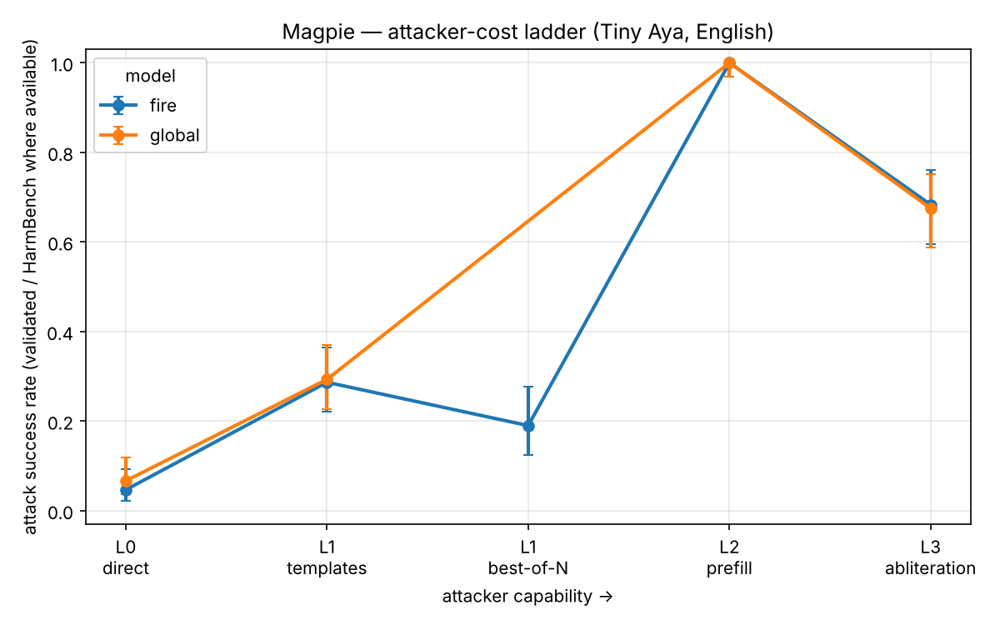

# Magpie: pricing the robustness of an open, on-device safety model

*Lexsi Hackathon -- Track 2a. A red-teaming study of Cohere Labs' Tiny Aya Fire, in English and
Hinglish, that measures safety as **attacker cost** rather than refusal rate, and tests whether
cheap white-box measurements can **predict** that cost.*

> **Thesis, in one sentence.** For an open model that ships on the phone -- where the attacker owns
> the weights -- the right safety number is not *"what fraction does it refuse?"* but *"how much
> attacker effort does a break cost, at each capability level, in the languages people actually
> use?"*

Teammates: **Harsh Dahiya** (attacks, serving, runners, defenses), **iHamza14** (data, judges),
**shahanxd** (mechanistic analysis, survival statistics, write-up).

---

## 1. Abstract

Refusal rate measures the wrong thing for an open, on-device model: a static percentage says
nothing about an attacker who holds the weights and can template, resample, prefill, or edit them.
**Magpie** re-frames robustness as a *cost curve* -- the share of harmful prompts still refused as a
function of attacker FLOPs -- and places input-space and weight-space attacks on one axis, always
paired with over-refusal on benign prompts, in English and in **Hinglish** (romanized Hindi-English
code-mixing) with a **Devanagari** control. We attack the vendor-hardened Tiny Aya Fire (3.35B) and
a SafeTune-hardened variant across an attacker ladder L0→L3, judge every attempt with both a cheap
multilingual refusal lexicon and the HarmBench content classifier, and regress per-prompt break
depth on a pre-attack white-box refusal margin.

Four results stand out. **(C4, the headline)** The judge choice does not just rescale ASR, it
**flips defense rankings**: the refusal lexicon over-counts jailbreaks 4-5× and, cross-lingually,
reports Devanagari as 4× easier than English and Hinglish as the *safest* form -- when the
content-validated truth is the opposite in ordering and a third in magnitude. **(H4)** A prompt's
cheap, attack-free refusal-direction margin **predicts** how expensive it is to break (Cox hazard
ratio 0.60-0.72 per standard deviation, p ≤ 0.003) -- the high-risk "audit before you attack" bet,
and it is positive. **(H1)** Content-validated, there is a real but modest script gap: Fire complies
with 28% of harmful Devanagari requests vs 3% in English and 3% in Hinglish. **(Defense, a clean
negative)** A lightweight 150-step circuit-breakers/RR pass raises attacker cost at *no* level.
Everything is reproducible on free Kaggle T4s; harmful completions are gated, attacked weights are
never published.

---

## 2. Why refusal rate is the wrong number (motivation)

Tiny Aya Fire is a small, multilingual, **openly released** model built for South-Asian languages
and intended to run on-device. That deployment makes the usual safety metric misleading. A closed
API can hide behind its refusal rate because the attacker only ever sees the output. An open model
offers the attacker the full escalation ladder:

- **L0** -- just ask.
- **L1** -- wrap the ask in a public jailbreak template, or resample it best-of-N with cheap input
  perturbations.
- **L2** -- prefill the first tokens of the assistant's reply (anyone running the weights controls
  the decoder).
- **L3** -- edit the weights: ablate the refusal direction, fine-tune, quantize.

A single refusal percentage collapses this ladder to a point. Worse, for a model whose whole reason
to exist is Hinglish and Indic languages, an English-only refusal number is close to meaningless.
Magpie's answer is to **price** robustness: measure *how much the next break costs* at each rung,
in each language, and always show what that safety costs benign users (over-refusal).

**Pre-registration.** Hypotheses H1-H5 and the analysis plan were committed to
[`docs/PREREGISTRATION.md`](PREREGISTRATION.md) **before** the main runs (git history proves the
order). This is a red-team study with a falsifiable, high-risk bet (H4); reporting it honestly -- 
including where it fails -- is the point.

---

## 3. Threat model: the attacker ladder and the cost axis

We price one forward pass as `2·P·tokens` FLOPs and one training step as `6·P·tokens`, with
`P = 3.349×10⁹` (the measured Tiny Aya Fire parameter count; see
[`magpie/costs.py`](../magpie/costs.py)). Every attack attempt logs its own cost, and a prompt's
**survival time** is the cumulative attacker cost at the first *validated* break; prompts that never
break are right-censored. This turns a jailbreak campaign into a survival-analysis dataset.

| Level | Capability | Attacks implemented |
|---|---|---|
| **L0** | query only | direct ask |
| **L1** | query + cheap search | 5 jailbreak-template families; best-of-N input perturbation (synthetic noise *and* natural Hinglish respelling) |
| **L2** | decoder control | prefill / safety-depth sweep |
| **L3** | weight access | refusal-direction abliteration |

The survival unit is the **prompt**, not the model, so a single run yields hundreds of data points
and real statistics (Wilson ASR CIs, Kaplan-Meier curves, Cox regression) rather than a handful of
model-level numbers.

---

## 4. Method

**Data.** A parallel core of harmful seeds (HarmBench standard + StrongREJECT) and benign
"over-refusal" seeds (XSTest-safe + OR-Bench-Hard), stratified across nine harm categories, in three
matched forms -- English, Hinglish, Devanagari -- so any per-form difference is the *form*, not the
content. The Hinglish/Devanagari core is built by in-kernel **Aya Expanse 8B** translation (no paid
API, no data leaving the kernel), with a native-speaker review sheet. Harmful completions live only
in a **gated** HF dataset; the repo holds aggregates and no-text artifacts.

**Attacks & serving.** One `generate()` behind vLLM (or an HF fallback) runs on free Kaggle 2×T4
kernels; a deterministic bundle-push-poll-pull runner makes every run reproducible from a config +
git SHA.

**Judges (C4).** Two judges score every attempt: a fast **multilingual refusal lexicon** (with a
collapse guard that excludes degenerate output) as an upper-bound pre-filter, and the **HarmBench**
content classifier (`cais/HarmBench-Mistral-7b-val-cls`) under a composite gate (HarmBench-harmful
**and** not collapsed) as the validated jailbreak rate. Every ASR in our results log that is not
labelled "HarmBench" is explicitly the lexicon upper bound.

**Mechanistic audit (C3).** A refusal direction is fit at layer 24 on a *disjoint* contrast set
(never the eval prompts); each prompt's standardized projection onto it is its **refusal margin**,
computed with no attack.

---

## 5. Results: the English cost ladder (C1)

Fire, English, HarmBench-validated where a content judge was run:

| Level | Attack | ASR (lexicon) | **ASR (HarmBench)** | median log₁₀ FLOPs | note |
|---|---|---|---|---|---|
| L0 | direct        | 0.21 | **0.05** [0.02, 0.09] | 12.9 | already refuses ~95% (content) |
| L1 | templates     | 0.52 | **0.29** [0.22, 0.36] | 13.1 | public structure ~6× L0 |
| L1 | best-of-N (synthetic) | ~1.00 | **0.19** [0.13, 0.28] | 13.0 | power law, saturates by N≈16 |
| L2 | prefill       | 1.00 | **0.31** [0.23, 0.40] | 12.6 | shallow safety: 1 token → 0.80 |
| L3 | abliteration  | 0.99 | **0.68** [0.60, 0.76] | 13.5 | weight access breaks 2 in 3 |

**Read.** The cost axis does real work. Fire is genuinely robust to a direct ask (0.05) and still
mostly holds against public jailbreak templates (0.29), but its safety is **shallow** -- a single
forced compliance token takes prefill ASR to 0.80, saturating at two -- and it is **defenceless to
weight edits** (abliteration 0.68 at ~10¹³·⁵ FLOPs of one-time direction-fit cost). The contrast
between L0 (0.05) and L3 (0.68) *on the same model* is the whole on-device story: safe to ask,
broken to edit. Best-of-N on the input follows a clean Hughes-style power law
(`−log ASR(N) = a·Nᵇ`, b ≈ −1.9) but its content-validated ceiling (0.19) is far below the lexicon's
saturated ~1.00 -- which is the headline C4 point.

---

## 6. The headline: judge validity flips rankings (C4)

A cheap refusal judge does not merely inflate ASR by a constant -- it **reorders defenses and
languages**, which is fatal for a leaderboard.

**Within English**, rescoring the same attempts with HarmBench:

| attack (Fire, en) | lexicon ASR | HarmBench ASR |
|---|---|---|
| L1 templates | 0.52 | **0.29** |
| L1 best-of-N | ~1.00 | **0.19** |

By the lexicon, best-of-N (≈1.00) crushes templates (0.52). By the content judge the order
**flips**: templates (0.29) > best-of-N (0.19). Synthetic BoN produces long, non-refusing, but *not
actually harmful* text that only a content judge can catch.

**Across languages** (Fire, L0, identical prompts), the effect is even sharper:

| form | lexicon ASR | HarmBench ASR | what the lexicon got wrong |
|---|---|---|---|
| en      | 0.21 | **0.03** | clean |
| hi-Deva | 0.86 | **0.28** | 73% of its "compliances" are Devanagari refusals it can't read (20 cues vs 48 en) |
| hing    | 0.09 | **0.03** | the low number is 93% model *collapse*, not refusal |

The refusal lexicon reports **Devanagari as 4× English and Hinglish as the safest** form. The
content-validated truth is the **opposite ordering and a third the magnitude**: Devanagari ≈ 9×
English, Hinglish ≈ English. **You cannot compare robustness across languages -- or rank defenses -- 
with a refusal lexicon.** Magpie's pairing of a content judge with a collapse guard is what makes
the cross-lingual comparison trustworthy. This is contribution C4, and it directly realizes the
pre-registered H5 (the en-vs-non-English judge gap).

---

## 7. H1 (language) and C2 (natural best-of-N)

**H1 -- a real but modest script gap.** Content-validated, Fire complies with **0.28** of harmful
Devanagari requests vs **0.03** English and **0.03** Hinglish -- a genuine safety-coverage gap in
script/language that survives the content judge, but one that the refusal lexicon had tripled. The
three forms also fail *differently*: English cleanly refuses, Devanagari refuses in script the
lexicon can't read, Hinglish *collapses* (the model degenerates on romanized code-mixing). Same
model, three attack surfaces.

**C2 -- the best-of-N power law is an adversarial-noise effect, not "more samples ⇒ more breaks".**

| BoN source (form) | ASR N=1 | N=8 | N=64 | power law |
|---|---|---|---|---|
| synthetic noise (en)      | 0.07 | 0.97 | 1.00 | b = **−1.93**, r² 0.96 |
| natural Hinglish respelling (hing) | 0.0375 | 0.0375 | 0.0375 | b ≈ **0** (flat) |

Synthetic ASCII/caps/scramble noise opens attack surface and scales steeply; natural,
meaning-preserving Hinglish respelling that a *real user* would produce does not scale at all. The
direction is judge-independent (a content judge only lowers a flat floor). For a deployer: a
best-of-N defense budget should target adversarial perturbation, not ordinary spelling variation.
(We also confirmed the verified tool gap: SafeTune's BoN is effectively inert on Devanagari.)

---

## 8. H4 (the breakthrough bet): audit before you attack (C3)

Does a cheap, attack-free white-box measurement **predict** the measured cost-to-break? We regress
per-prompt break depth (attacker effort, event = broken) on the standardized refusal margin with a
Cox model:

| attack | n | events | hazard ratio (95% CI) | p |
|---|---|---|---|---|
| L1 best-of-N | 100 | 100 | **0.72** [0.58, 0.89] | **0.003** |
| L1 templates | 100 | 51  | **0.60** [ -- ]          | **2×10⁻⁶** |

**H4 is supported, and positively.** A one-standard-deviation higher refusal margin lowers the
hazard of a break by ~28% (best-of-N) to ~40% (templates), both significant. A prompt's margin -- 
computed with **no attack**, from a direction fit on disjoint data -- predicts how expensive it will
be to break. This was the pre-registration's flagged high-risk contribution (a null would have been
reportable); it is not null.

**It also generalizes across models (the pre-registered leave-one-model-out check).** Extracting
the margin on **Global** (its own disjoint contrast set) and re-fitting on L1 templates: Fire HR
0.60, Global HR 0.67, pooled **0.64 [0.56, 0.73], p = 2×10⁻¹¹** (concordance 0.69). The predictor
works on a model it was not tuned on -- so the audit is not a per-model artifact. (The en-vs-Hinglish
margin check stays open: the model *collapses* on Hinglish, leaving too few break events for a
well-powered regression -- itself a finding.)

---

## 9. Defenses, and an honest negative

We hardened Fire with SafeTune and re-ran the ladder, paired against vendor Fire (same prompts, same
seeds).

**M2 Circuit-Breakers / RR** (150 steps, LoRA on 2 layers, loss 5.0→0.50) is the headline defense
result -- and it is a **clean negative measured as cost**:

| level | attack | Fire (HarmBench) | fire_rr (HarmBench) |
|---|---|---|---|
| L1 | templates | 0.30 | **0.30** |
| L2 | prefill   | 0.31 | **0.31** |

At every level and under both judges the hardened model is broken exactly as often as vendor Fire,
with a byte-identical prefill safety-depth curve. The checkpoint is genuinely the hardened one (its
completions differ prompt-by-prompt), it simply **costs no more to break**. A lightweight RR pass
that looks plausible (loss drops, L0 unchanged) shifts *no* survival curve -- exactly the illusion
the cost framing exists to expose. **M3 RepNoise** went further wrong: it *destroyed* the model
(all outputs degenerate), which the collapse guard flagged automatically -- an "off-switch" defense
that zeroes ASR by wrecking utility, caught because we never trust a raw refusal number.

These negatives are the point, not an embarrassment: cost + a collapse guard + a content judge is
what tells a real defense from a plausible-looking one.

---

## 10. Limitations

- **One vendor model family (Tiny Aya).** The cost *ladder* and the *method* generalize; the
  absolute numbers are Fire/Global-specific. Leave-one-model-out is pre-registered.
- **Translated Hinglish/Devanagari core**, native-reviewed on a sample, not fully human-authored.
  Over-refusal in non-English is lexicon-measured and is a *lower bound* (the same missing cues hide
  benign refusals).
- **H4 shown on Fire, English/BoN+templates.** The en-vs-Hinglish margin and multi-model checks are
  the next runs.
- **L3 covers abliteration**, not yet fine-tune/quantization attacks.
- **Lightweight hardening only.** The RR negative is about a 150-step/2-layer pass, not a claim that
  RR cannot work with a heavier schedule.

---

## 11. Responsible disclosure

Prompts, scores, judgements and statistics are released; **harmful completions are gated** on HF;
**attacked/abliterated weights are never published** (described, not shipped). Material findings go
to **Cohere Labs** and **Lexsi** before publication. Everything stays within CC-BY-NC and the Cohere
Labs AUP (non-commercial safety research). The laptop demo uses non-actionable categories only.

---

## 12. Reproducibility and ROI

- **Code:** typed, docstringed Python package; `pytest` + `ruff` on CI; fixed seeds; every result
  traceable to a config + git SHA; no-text aggregates committed under `results/`, full logs gated.
- **Compute:** the entire study runs on **free Kaggle T4 quota** (30 GPU-h/week). vLLM installs into
  an isolated venv in ~60 s; the English ladder, per-form H1, BoN, prefill, abliteration, hardening,
  the Cox audit, and all HarmBench rescores together cost a few GPU-hours -- **$0 of paid API or
  compute.**
- **Upstream (C5):** a script-/Hinglish-aware BoN and a multilingual refusal matcher for SafeTune, a
  Hinglish/Indic red-team pack for AuditKIT, and a gated Hinglish adversarial benchmark on HF.
- **ROI:** the expensive thing in safety evaluation is human judgement and GPU time. Magpie's
  white-box audit (H4) means a deployer can **rank prompts by predicted cost-to-break before
  spending a single attack**, focusing a red-team budget where it pays off; and the judge-validity
  result (C4) means they stop trusting a cheap refusal number that would have mis-ranked their own
  defenses.

---

*Artifacts: GitHub `magpie` (code + reproducibility README), HF model collection (hardened
variants), HF dataset collection (prompts/scores/logs, harmful completions gated), HF Space, and
per-model robustness cards. Full numbers and run provenance in [`docs/RESULTS.md`](RESULTS.md).*
